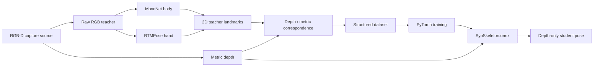

# Kinect Depth AutoLearn

**Kinect Depth AutoLearn** is a Processing + ONNX/PyTorch pipeline for building a **depth-only structured human-pose model** from synchronized RGB-D Kinect data.

The RGB model acts as a temporary teacher during dataset capture. The trained student model consumes **metric depth only** and predicts body, hands, fingers, skeletal segments, and structural endpoints.

The project supports Kinect 360 and Kinect v2 capture paths while keeping the training representation sensor-independent.

---

## Highlights

- Depth-only student ONNX model
- 58 landmarks with **no eye landmarks**
- Head, body, arms, legs, both hands, and all finger chains
- Structural segment and endpoint supervision, not keypoints alone
- Raw, unfiltered RGB teacher input
- Improved RTMPose-Hand SimCC decoding and hand validation
- CPU, NVIDIA/CUDA, and AMD/DirectML training backends
- Remold, Microsoft Kinect SDK, OpenKinect/libfreenect, and Kinect v2 capture sources
- Fullscreen responsive Processing dashboard with CLOSE and MINIMIZE controls
- 80 ms minimum capture-candidate polling with diversity gating, and 100 ms training-progress refresh
- Per-finger colors shared by landmarks and connecting segments
- Automatic recovery of the newest valid dataset session
- Safe training pause/resume with optimizer + scheduler checkpoints
- Automatic resume after interruption and periodic crash-safe checkpoints
- Console training ETA/status when launched from `train_depth_pose.bat`

---

## Architecture



The RGB teacher is used only to generate supervision during capture. The final student model can run from metric depth without RGB. After training, the full-frame ONNX artifact is written as `output/SynSkeleton.onnx`. When sufficient hand supervision exists, `output/SynHand.onnx` is also trained and loaded automatically for high-resolution finger refinement. `output/SynSkeleton_layout.json`, `dataset_split.json`, and `quality_report.json` are written beside them.

---

## Capture sources

Press the corresponding key in the Processing application:

| Key | Source | Sensor | Notes |
|---|---|---|---|
| `1` | Remold | Kinect 360 | Uses the existing Remold RGB + metric-depth pipe |
| `2` | Microsoft Kinect SDK 1.8 | Kinect 360 | Native bridge, requires Kinect for Windows SDK 1.8 |
| `3` | OpenKinect / libfreenect | Kinect 360 | Native bridge, requires an x64 libfreenect build |
| `4` | Microsoft Kinect SDK 2.0 | Kinect v2 | Native bridge with SDK 2.0 coordinate mapping |

All capture sources are normalized to the same internal contract:

```text
RGB   : 640 x 480 ARGB/BGRA
Depth : 640 x 480 uint16 millimeters
```

### Kinect v2 alignment

Kinect v2 natively provides 512×424 depth and 1920×1080 color. The SDK 2.0 bridge uses `CoordinateMapper` to relate depth, camera, and color space before the frames are converted to the project's canonical metric geometry.

A source change pauses capture and creates a new dataset session. This prevents accidental mixing of different sensor calibrations in the same capture session.

---


## Session recovery and safe continuation

At startup the Processing application now searches `dataset/session_*` and reopens the newest valid session automatically. It verifies rows against existing depth PNGs, restores the sample count, opens `labels.csv` in append mode, and chooses the next unused numeric filename. This prevents old samples from being overwritten.

`R` still creates a deliberately new session.

Training is checkpointed to `output/last.pt` every 100 batches and whenever a pause is requested. The checkpoint contains the model, optimizer, scheduler, epoch/batch position, early-stopping state, ETA timing state, and best validation value. Press `P` to pause/resume a running training process. Pressing `T` later resumes automatically from `last.pt`.

If the program or machine stops unexpectedly, the next training launch resumes from the latest periodic checkpoint; at most a small number of batches need to be repeated.

## Training launch and logs

Training is launched directly from Processing with the Python interpreter recorded in `runtime_python.txt`. The GUI does not depend on `cmd.exe` or an intermediate batch file for normal training, which makes paths containing spaces safe.

Before the process starts, the application creates both output locations:

```text
output/latest_training.log
dataset/session_YYYYMMDD_HHMMSS/output/train.log
```

If training exits with code `1`, open `output/latest_training.log` first. The session-specific `progress.json` is also created as soon as the Python trainer starts and records structured errors when possible.

When `train_depth_pose.bat` is started without a dataset argument it automatically selects the newest valid session. The console prints dataset size, backend, resume checkpoint, elapsed time, percentage and ETA every 15 seconds. Helper scripts `pause_training.bat`, `resume_training.bat`, and `training_status.bat` control the newest session (or accept an explicit session path).

The ETA includes measured training batches and validation batches, rather than extrapolating training time alone.

Teacher/student inference and training-progress publication are targeted at **100 ms**. Dataset capture checks candidates after a minimum **80 ms**, but SynSkeleton v2 stores a frame only when the landmark/depth novelty gate accepts it (or after the slow static keep-alive interval). The Processing UI renders at 30 FPS so buttons and fullscreen interaction remain smooth; neural-network work itself is not artificially delayed if an operation takes longer than the target cadence.

## Training backends

Run:

```bat
install_autolearn.bat
```

Then choose:

| Option | Backend | Typical use |
|---|---|---|
| `1` | Automatic | Detects NVIDIA, AMD Radeon, or falls back to CPU |
| `2` | CPU | Most compatible |
| `3` | NVIDIA / CUDA | NVIDIA GPUs |
| `4` | AMD / DirectML | AMD Radeon / DirectX 12 |

The resolved backend is stored persistently. Automatic mode selects NVIDIA/CUDA when an NVIDIA adapter is present, AMD/DirectML for Radeon/AMD adapters, and CPU otherwise. A DirectML graph failure is reported clearly and the trainer can fall back safely to CPU.

AMD/DirectML uses a dedicated **Python 3.10** runtime, plus a DirectML-safe training path with float32, conservative batch sizing, non-foreach optimizer operations, and a complete forward/backward self-test before epoch 1. The DirectML environment is created directly with Python 3.10.

---

## Installation

### Requirements

- Windows 10/11
- Processing 4
- Kinect capture driver/SDK for the source you intend to use
- Internet access during initial runtime/model installation

### Setup

1. Extract the repository.
2. Run `install_autolearn.bat`.
3. Select the training backend.
4. If using a native Microsoft/OpenKinect source, build its bridge.
5. Open `app/KinectDepthAutoLearn/KinectDepthAutoLearn.pde` in Processing 4.
6. Run the sketch.

The installer keeps its Python environment and package cache under `%LOCALAPPDATA%\KinectDepthAutoLearn`, rather than depending on the system Python installation. For AMD/DirectML, the managed interpreter is pinned to Python 3.10.

---

## Optional native bridges

From an **x64 Native Tools Command Prompt for Visual Studio**:

```bat
bridges\build_bridges.bat
```

### Microsoft Kinect SDK 1.8

Requires the Kinect for Windows SDK 1.8 development environment.

### Microsoft Kinect SDK 2.0

Requires the Kinect for Windows SDK 2.0 development environment.

### OpenKinect / libfreenect

Requires an x64 libfreenect build. Its DLLs must be discoverable through `PATH` or placed beside the bridge executable.

Native bridges run outside the Processing JVM so SDK DLLs and libfreenect do not collide inside Java.

Only one driver stack should control a physical Kinect at a time.

---

## Controls

| Key | Action |
|---|---|
| `A` | Start / pause automatic dataset capture |
| `X` | Pause capture |
| `T` | Start training / resume from checkpoint |
| `P` | Pause / resume the running training process safely |
| `V` | Toggle Teacher / Student view |
| `L` | Reload the newest trained ONNX |
| `R` | Create a new dataset session |
| `1` | Remold source |
| `2` | Microsoft Kinect SDK 1.8 |
| `3` | OpenKinect / libfreenect |
| `4` | Microsoft Kinect SDK 2.0 / Kinect v2 |

The dashboard runs fullscreen and scales cards, previews, text, progress bars, and the command bar from the actual display dimensions. The header includes a Windows-aware **MINIMIZE** button as well as **CLOSE**.

---

## RGB teacher path

The RGB teacher input is intentionally **unfiltered**.

The current RGB frame is passed to the model using only the preprocessing required by the ONNX network:

- crop / resize
- channel layout conversion
- model-required numeric normalization

The RGB image path does **not** use blur, denoise, sharpening, temporal image filtering, or image interpolation filters.

### Hand tracking stability

The RGB hand teacher uses RTMPose-Hand with the same crop geometry and SimCC confidence mapping used by the earlier Body3D application, where hand acquisition was more reliable. The primary detector remains strict; false-negative filtering is performed temporally after inference rather than by lowering raw detection thresholds.

- forearm-derived ROI scale and forward offset restored from Body3D
- original sigmoid mapping of RTMPose SimCC logits restored for the RGB teacher
- eight reliable landmarks remain the raw acceptance requirement
- both hands are evaluated with identical thresholds on every capture cycle
- sub-pixel/model jitter receives only light motion-adaptive smoothing
- a complete missing hand is removed immediately instead of being retained or synthesized
- isolated landmark outliers are constrained/repaired only while a coherent hand is detected in the current frame
- longer losses can switch briefly to the compact-fist wrist/palm representation instead of preserving stale fingers
- 3D hand depth can use nearby points just outside the body mask, reducing wrist/hand edge dropouts
- student output keeps its short temporal stability filter so one weak frame does not erase a finger chain

These measures preserve the stronger Body3D hand detector while suppressing momentary false negatives.

---

## Metric landmark layout

The student predicts **58 landmarks**.

| Indices | LANdmarks |
|---|---|
| `0` | Head center |
| `1` | Nose |
| `2` | Left ear |
| `3` | Right ear |
| `4..15` | Shoulders, elbows, wrists, hips, knees, ankles |
| `16..36` | Left hand, 21 landmarks |
| `37..57` | Right hand, 21 landmarks |

Eye landmarks are intentionally excluded.

---

## Finger visualization

Each finger keeps one color from its base through its fingertip. The same color is used for both landmarks and connecting lines:

- Thumb — orange
- Index — cyan
- Middle — green
- Ring — violet
- Little — pink

This convention is used in teacher overlays, accepted metric samples, student inference, and the 3D hand view.

---

## ONNX outputs

The exported model provides three structural outputs.

### `keypoints`

```text
[N, 58, 4]
```

Each landmark contains:

```text
x_normalized, y_normalized, z_mm, confidence
```

### `segments`

```text
[N, 59, 8]
```

Each segment contains:

```text
x1, y1, z1, x2, y2, z2, confidence, length_mm
```

### `endpoints`

```text
[N, 18, 4]
```

This output contains important structural endpoints such as head references, wrists, ankles, and fingertips.

`SynSkeleton_layout.json` is exported beside `SynSkeleton.onnx` and documents the landmark order and indices used by the structural outputs.

---

## Structural training

Training does not optimize isolated landmarks only. The loss includes:

- heatmap localization
- normalized XY error
- metric Z error
- presence / confidence
- segment direction consistency
- segment length consistency
- stronger endpoint supervision

This encourages coherent arms, forearms, legs, palms, and finger phalanges instead of treating every joint as an unrelated point.

---

## Dataset capture

Capture candidates are polled at approximately **80 ms**, but a frame is stored only when the pose, landmark visibility, or coarse depth geometry has changed meaningfully. A slow keep-alive sample preserves long static poses without filling the dataset with adjacent duplicates.

A candidate must still pass RGB/depth synchronization, head/body coverage, depth validity, and structural checks. Hands are optional on an individual frame, but automatic full-quality training waits for **12,000 diverse body samples plus at least 3,500 useful samples for each hand**. Unreliable hand tracks remain masked instead of being used as targets.

A typical session contains:

```text
dataset/
  session_YYYYMMDD_HHMMSS/
    depth/
      0000000.png
      0000001.png
      ...
    labels.csv
    source.txt
    output/
```

---

## Training progress

The trainer publishes progress to the Processing dashboard roughly every **100 ms**.

A project-level log is always created at:

```text
output/latest_training.log
```

The active session also keeps its own training artifacts under `dataset/session_.../output/`. The project-level log exists specifically so a launch failure is easy to find even when training never reaches epoch 1.

The UI reports:

- backend/device
- epoch and batch
- training loss
- validation loss
- best validation score
- elapsed time
- ETA
- completion/error state

The 100 ms value is a progress-update cadence. It does not mean every neural-network batch must complete in 100 ms.

---

## Recommended workflow

1. Start with a short capture to verify the full pipeline.
2. Confirm that head, torso, arms, wrists, and hands align correctly.
3. Capture varied poses rather than many nearly identical frames.
4. Keep hands away from the torso when collecting finger examples.
5. Include open hands, closed hands, spread fingers, flexed fingers, and different wrist rotations.
6. Train a preliminary model.
7. Inspect the Student view.
8. Capture more examples specifically for the poses where the student is weak.
9. Retrain and compare validation behavior.

Dataset diversity matters more than simply maximizing the frame count.

---

## Troubleshooting

### Hand landmarks flicker or disappear

- Keep the full forearm and wrist visible.
- Avoid placing the hand directly over the torso during early dataset collection.
- Move closer to the sensor for finger-specific captures.
- Check the hand confidence/coverage indicator before accepting the session as representative.

### AMD training fails before epoch 1

Run `install_autolearn.bat`, select `4` (AMD / DirectML), and let the installer create the managed DirectML environment with Python 3.10. The DirectML path then performs a graph self-test first. Check:

```text
runtime_status.json
session_.../output/progress.json
session_.../output/train.log
```

A failed DirectML self-test is reported as an error rather than silently changing to CPU.

### Native bridge does not connect

Verify that:

- the bridge executable was built successfully
- the correct Kinect SDK/driver is installed
- required runtime DLLs are available
- another Kinect driver stack is not currently controlling the device

### Student ONNX is not available

Train a dataset session first, then use `L` to reload the latest model.

---

## Project layout

```text
KinectDepthAutoLearn/
  app/
    KinectDepthAutoLearn/
      KinectDepthAutoLearn.pde
      BodyTracker3D.pde
      DashboardUI.pde
      DatasetRecorder.pde
      RemoldDriver.pde
      RgbdSources.pde
      StudentDepthEngine.pde
      Teachers.pde
      data/
      code/

  install_autolearn.bat
  install_autolearn.ps1
  diagnose_runtime.bat
  train_depth_pose.bat

  trainer/
    diagnose_runtime.py
    train_depth_pose.py

  bridges/
    build_bridges.bat
    src/
      BridgeProtocol.h
      microsoft_kinect_v1_bridge.cpp
      microsoft_kinect_v2_bridge.cpp
      openkinect_bridge.cpp
```

All Processing `.pde` files intentionally live together in the internal runnable sketch folder `app/KinectDepthAutoLearn/`. The repository root contains installation, training, bridge, dataset, and output infrastructure.

---

## Model and sensor limitations

Kinect depth resolution is much lower than modern RGB camera resolution. Body and arm structure can be observed directly in depth, but individual fingers may be partially inferred from learned anatomy when the sensor cannot spatially resolve them.

The RGB hand teacher is also a top-down hand model: a useful wrist/forearm localization is required to build the hand crop. Poor body wrist detection therefore affects hand detection quality.

---

## References

- OpenMMLab MMPose / RTMPose: https://github.com/open-mmlab/mmpose
- RTMPose hand model family: https://github.com/Tau-J/rtmlib
- OpenKinect / libfreenect: https://github.com/OpenKinect/libfreenect
- PyTorch: https://pytorch.org/
- ONNX Runtime: https://onnxruntime.ai/
- Microsoft DirectML: https://learn.microsoft.com/windows/ai/directml/

---

## License

No project license is asserted by this README. Add a `LICENSE` file appropriate for your intended GitHub distribution before publishing the repository.

---

## Robustness improvements

Training status and checkpoint writes tolerate transient file locks using retries and fallback writes.

The hand pipeline uses the proven Body3D RGB detector as its primary source and adds post-inference geometry/stability filtering. A complete missing hand is removed immediately and is never synthesized or retained. Only isolated landmarks of a currently detected hand may be constrained or repaired from the previous palm-relative geometry.

## SynSkeleton v2 quality pipeline

Validation is grouped in time instead of randomly mixing neighboring camera frames: the default uses 30-second temporal groups plus a 1.5-second guard around validation windows. Horizontal flips swap left/right labels correctly, affine augmentation transforms depth and landmarks together, and range perturbation updates metric Z labels consistently.

The full-frame student predicts 58 landmarks from 320×240 normalized depth with 160×120 heatmaps and local metric-depth Z extraction. A shared `SynHand.onnx` refiner then uses 128×128 crops from the original depth frame and 64×64 heatmaps to refine 21 landmarks per hand. Exported ONNX models are self-tested before the run is marked complete, and `quality_report.json` records body/hand validation errors.
